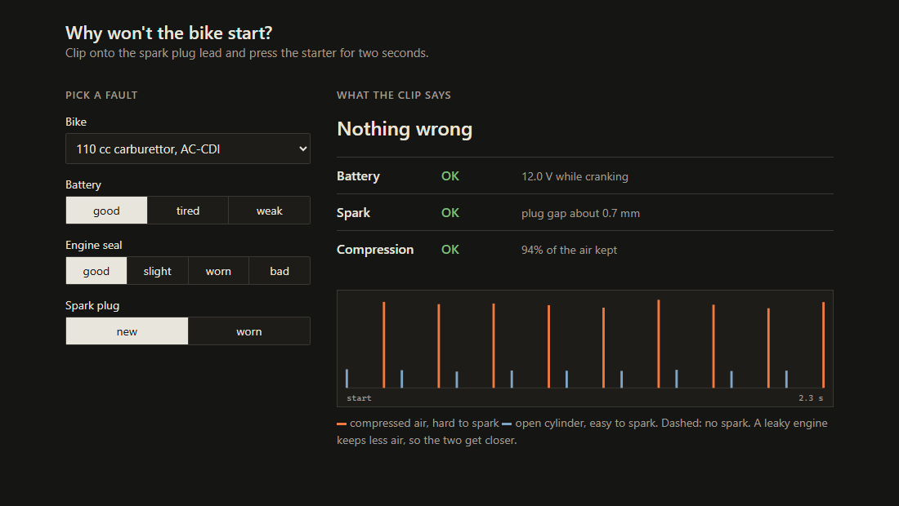

> [!NOTE]
> **Status:** This project is inactive and no longer updated.

A motorbike cranks but will not start. Flat battery, weak spark or worn rings? Clip onto the plug lead and press the starter for two seconds.

The plug fires every revolution, once at compression and once at exhaust. Breakdown voltage follows gas density, so the ratio of the two peaks reads how much air the cylinder holds, whatever the clip coupling. The time between sparks gives crank speed, and a starter and cylinder model turns that into battery voltage under load.

- `physics/`: slider-crank, flywheel inertia, cylinder gas with blow-by and wall heat loss, starter motor and battery, Paschen breakdown in the plug tip field, CDI and TCI coils, capacitive clip, ADC
- `rtl/`: spark capture at 100 MSa/s (peak, breakdown, burn time, level-crossing times), async FIFO, UART
- `model/`: bit-exact Python model of the capture
- `host/`: C++ fit of both readings, error propagation, verdict or refusal
- `web/`: pick a fault, see what the clip says

| LUT | FF | BRAM | clock |
|---|---|---|---|
| 5.0% | 5.2% | 0.5 | 100 MHz, met |

    pip install -r requirements.txt
    python studies/paschen_fit.py
    python model/rtl_check.py
    python cases/build_cases.py
    python -m pytest

`host/` and the RTL checks run under WSL (g++, iverilog). `synth/top.tcl` is the Vivado batch script. Open `web/index.html`.

Air breakdown: uniform-field curve of Dakin et al. (1974), as given in Kuffel, Zaengl and Kuffel, *High Voltage Engineering*.
